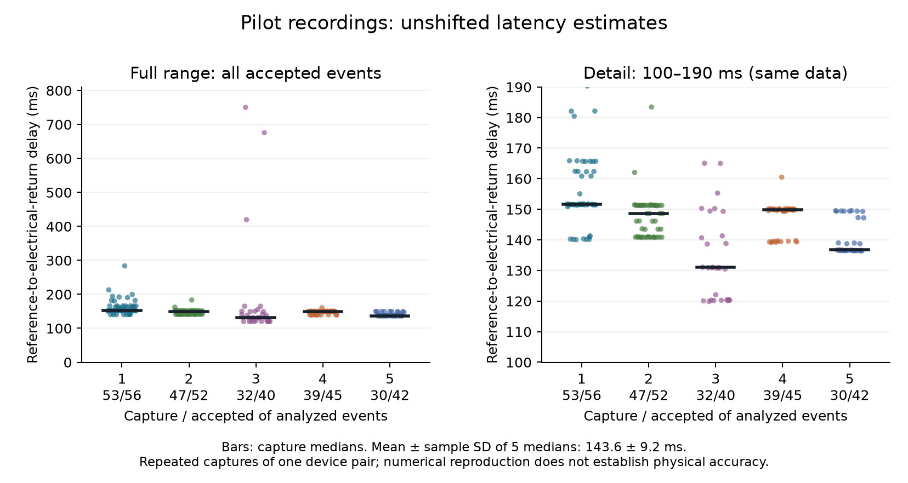
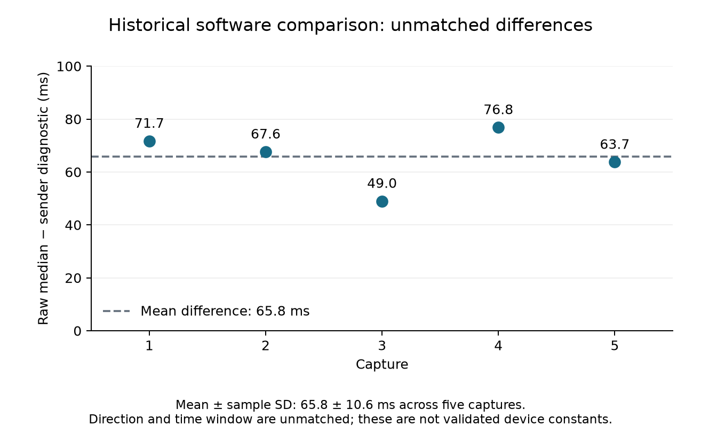

# EarShot

Tools for measuring WebRTC audio-path delay and comparing recordings with browser telemetry.

EarShot combines a C++ measurement rig, a minimal browser client and a room server for repeatable proximity-voice experiments:

- **Measurement rig:** generates test signals and analyzes stereo recordings, preserving unshifted delay estimates.
- **Browser client:** both devices load the same revised voice code, with proximity controls and receiver telemetry tied to each capture.
- **Room server:** serves the client and coordinates membership, tile positions and signalling. Audio travels through WebRTC, directly or through TURN.
- **Experimental scope:** proximity is based on virtual tile positions, with a grace window before departing links close. No game application is required; this does not implement physical MANET routing.

**From PROX-VOICE to EarShot:** development has moved from [PROX-VOICE](https://github.com/khan-u/prox-voice), now archived, to this repository. EarShot retains the original pilot data and builds on that code with revised measurement tools and a standalone experiment setup. New captures are stored separately from the pilot.

**Current status:** automated software checks pass. Two-device microphone/playout checks and physical timing validation remain necessary before collecting the expanded study data.

[Repository layout](#repository-layout) · [Pilot results](#pilot-results) · [Offline reproduction](#offline-reproduction) · [Live experiments](#live-experiments)

## Repository layout

```text
client/                  Minimal browser host, signalling server and source provenance
voice/                   TypeScript voice, negotiation, sensing and KPI modules
rig/                     C++17 stimulus generator, stereo WAV analyzer and fixtures
  tests/                 C++ DSP/WAV unit tests and Python synthetic recovery checks
experiments/
  lib/                   Browser helpers, tone generation and measurement helpers/tests
  rig-driver.cjs         Live Mac/phone capture; unshifted analysis and run manifests
  audiogap.cjs           Revised packet-interruption proxy (not audible silence)
  RUNSHEET-rig.md        Wiring, revised capture procedure and pilot limitations
  compare-rig-runs.sh    Re-analyze archived WAVs and print capture summaries
  plot-rig.py            Re-analyze WAVs, verify raw CSVs and regenerate both figures
  aggregate.py           Print historical telemetry summaries with existing filters
  baseline/              RTP-forwarding SFU comparison (werift + ws; no audio mixing)
  data/                  134 historical JSON/JSONL files and five WAV/CSV capture sets
  runs/                  New rig/packet-gap outputs (generated, ignored by Git)
docs/figures/            Architecture and reproducible pilot figures
```

Other harnesses cover formation (`harness.cjs`), mobility, grace windows, DTX, sensing, and failure diagnostics. They use the read-only controller probes described under **Live experiments** below.

## Pilot results

The pilot used **one device pair in one session**, with five repeated captures.

- **Accepted events:** 201 of 235 analyzed reference events.
- **Mean of the five capture medians:** 143.6 ms; sample SD 9.2 ms.
- **Pooled mean of accepted events:** 155.3 ms.
- **Scope:** the 9.2 ms value is a sample standard deviation, not a confidence interval. The five captures are not five independent sessions or device pairs, and the events are not independent experimental replications.

| Capture (UTC, 2026-08-25) | Analyzed | Accepted | Unshifted median (ms) | Sender KPI (ms) |
|---|---:|---:|---:|---:|
| 21:40:38 | 56 | 53 | 151.680 | 80 |
| 21:42:56 | 52 | 47 | 148.618 | 81 |
| 21:45:14 | 40 | 32 | 130.977 | 82 |
| 21:47:31 | 45 | 39 | 149.827 | 73 |
| 21:49:50 | 42 | 30 | 136.7125 | 73 |

### Measured path

The delay starts at the wired stimulus reference, passes through the earbud-to-Mac-microphone acoustic leg and WebRTC, and ends at the **phone adapter's electrical output**.

The listener's final speaker/headphone acoustic output is excluded. These are reference-to-electrical-return estimates for this setup; they do not establish a validated air-to-air mouth-to-ear measurement.

<p align="center"></p>

### Analysis settings and limits

The analyzer selects the highest normalized cross-correlation (NCC) peak within its lag-search window. Pilot reproduction uses `--min-corr 0.9 --min-lag-ms 30` and the following thresholds:

| Setting | Value |
|---|---:|
| Minimum NCC | 0.9 |
| Minimum lag | 30 ms |
| Maximum lag (default) | 1000 ms |
| Quality threshold (default) | 6 dB |

- **Quality score:** selected return-envelope level relative to the initial recording-envelope RMS. It is not a local signal-to-noise measurement.
- **Lag floor:** the 30 ms minimum restricts the search to reduce near-zero crosstalk; it is not a universal physical lower bound.
- **Long tail:** nine accepted estimates exceed 190 ms; three exceed 400 ms. These events and the within-capture clusters need further investigation. The recordings do not identify jitter-buffer excursions or audio-callback quantization as their cause.
- **Interpretation:** a mean below 150 ms does not establish a per-event or per-device latency guarantee.

### Software comparison

The model in `voice/metrics.ts` is:

```text
round(RTT/2 + jitter-buffer average + 40 ms)
```

- **Sampling:** every two seconds, ordinarily using changes in cumulative jitter-buffer counters. Initial, reset or non-advancing counters fall back to the lifetime ratio.
- **Summary:** `latRawMedianMs` summarizes retained per-link estimates, including earlier links. It is not a time median over a recording.

The pilot comparison has two mismatches:

- **Direction:** the laptop's local inbound jitter-buffer statistics describe the reverse of the measured laptop-to-phone path.
- **Window:** the driver read the laptop KPI once after each capture, without a matched measurement window.

Subtracting those sender diagnostics from the five unshifted capture medians gives **65.8 ± 10.6 ms** (mean ± sample SD). These are descriptive, unmatched differences; they do not establish a device constant or validated calibration.

<p align="center"></p>

The model already includes 40 ms. Adding the mean residual gives an effective additive term of **105.8 ms** above RTT/2 and jitter buffering. This arithmetic does not physically validate either term. Assumed capture/output and codec delays do not provide an independent reference for the residual.

### Provenance and unresolved checks

The [EarShot artifact (`ea7d2c6`)](https://github.com/khan-u/prox-voice/tree/ea7d2c6a6d880a1c41d97e4ca533b17441202c93) identifies the archived code and data. Exact browser builds were not recorded; see the [source provenance note](client/PROVENANCE.md). The revised harnesses and minimal host postdate the pilot.

**Unresolved timing discrepancy:** recorded reference-event spacing is approximately 1.53–1.77 s, despite a nominal 2 s stimulus period. Capture durations and event counts also differ from the nominal sequence. Recording continuity, stimulus configuration and time-base accuracy need physical checks; a global rescaling is not justified.

TO DO:

- Validate the rig using independent timing, crosstalk and disconnected-return controls.
- Collect receiver telemetry matched by direction and time, with build identifiers.
- Investigate ambiguous peaks and sensitivity to analysis gates.
- Repeat across independent sessions, device pairs and network conditions.

Numerical reproduction is available. Physical timing accuracy and generalized endpoint calibration remain to be established.

## Offline reproduction

Run all commands below from the repository root.

| Component | Requirement |
|---|---|
| Rig and recovery tests | C++17 compiler, `make`, Python >= 3.9 |
| TypeScript tests | Node.js >= 22.12 and dependencies installed with `npm ci` |
| Helper tests | Node.js >= 18; no browser/application needed |
| Historical aggregation | Python >= 3.9, standard library only |
| Figures | Python >= 3.9 and Matplotlib (requirements file below) |

### Build and test

```bash
make -C rig check
npm ci
npm test
npm run typecheck
node --test experiments/lib/*.test.cjs
npm run build:client
npm run test:client
```

- **Test environment:** helper and client tests do not launch a browser. The server test binds a temporary loopback port.
- **Synthetic recovery:** `make check` runs C++ unit tests and checks unshifted delays of 40, 85, 150 and 450 ms, with varied gain, noise and pre-roll. All 20 events must pass; median error must be <=0.1 ms and each event's error <=0.25 ms.
- **Negative controls:** disconnected-return and silent-reference fixtures must accept no events. The analyzer exits with status 3 when no events pass its gates.
- **Scope:** these tolerances apply to the specified ideal fixtures, not to physical recordings.

### Re-analyze recordings and regenerate figures

```bash
make -C rig
bash experiments/compare-rig-runs.sh
python3 -m venv .venv-figures
.venv-figures/bin/python -m pip install -r experiments/requirements-figures.txt
.venv-figures/bin/python experiments/plot-rig.py
```

- `compare-rig-runs.sh` prints per-capture summaries.
- `plot-rig.py` independently re-analyzes all five WAVs, checks every generated row against the archived `*-uncalibrated.csv` files, prints descriptive statistics and writes both PNGs under `docs/figures/`.
- Archived WAVs and CSVs are not overwritten. See the [data notes](experiments/data/README-rig-csv.md) for the shifted CSV variant.

### Historical telemetry tables

```bash
python3 experiments/aggregate.py
```

The script prints seven groups: formation/KPI/uplink, mobility, packet-gap results, sensing, network conditions, grace windows and DTX. It preserves these selection rules:

| Data | Selection rule |
|---|---|
| Formation/KPI/uplink | Last lexicographically sorted summary file per client count |
| Mobility | Complete cycles |
| Legacy packet gaps | Records with `valid: true` |
| Remote telemetry | Latest timestamped report per `(condition, session)` |
| Grace sweep | Nonnegative reconnect gaps, independently of whole-run validity |

Inspect these filters when interpreting sample sizes.

- **Interpretation:** aggregation reproduces stored telemetry; it does not validate every label or measurement.
- **Packet gaps:** legacy `totalSilenceMs` does not establish audible interruption. The artifact's harness and stored record formats differ, and its stop-plus-recovery arithmetic omitted the absence interval. Revised packet-gap records use a separate format and are excluded from these tables.
- **Latency:** report single-host loopback and real-network software estimates separately.

## Live experiments

### Start the client and room server

`npm run start:client` starts the included server. It serves the browser client, manages room membership and tile positions, and relays voice signalling and measurement messages. Audio travels through WebRTC, directly or through TURN; no separate game server is needed.

Run from the repository root:

```bash
npm ci
npm run build:client
npm run start:client
```

- **Local access:** the default server is available at `http://localhost:5001` on the Mac. It listens only on loopback; this address is not a phone-accessible setup.
- **Two-device access:** configure a reachable HTTPS address trusted by the phone, using the [TLS or reverse-proxy instructions](client/README.md#start-the-client). Use that address on both devices. Plain HTTP to the Mac's LAN address does not provide phone microphone access.
- **Manual audio check:** join the same room with different participant names, then enable voice and grant microphone permission on both devices. The [client instructions](client/README.md) also cover optional TURN and supported scenarios.
- **Automated rig capture:** join and enable voice on the phone with `?wsnmeasure=1`, keeping its page visible and the phone awake. Set `BASE_URL` to the same HTTPS address and room. The harness opens and joins the Mac sender automatically; close any manually joined Mac participant first. Harnesses use this repository's Playwright dependency and installed standard Chrome.
- **Physical rig:** Mac captures require `afplay`, `ffmpeg` with AVFoundation support, `SwitchAudioSource`, and the wiring in the [runsheet](experiments/RUNSHEET-rig.md).

### Supported host and interfaces

- **Minimal client:** omits game UI and conversation APIs. Its bundle does not load `HomeScreen.ts`, `VoiceChat.ts` or the conversation VAD helper. `DebugFlags.ts` supplies the logging toggle.
- **Full game:** requires the external client/server and the fuller controller on `revision/measurement-documentation`. The minimal controller is not a drop-in replacement. `TS_CLIENT` is an optional dependency-location override for that installation.
- **Comparison with the pilot:** removing the game workload changes the experimental conditions. Validate a new baseline before comparing results.

| Runtime interface | Purpose |
|---|---|
| `wsnGame.loggedIn()`, `pos()`, `teleport()` | Login and controlled movement |
| `wsnVoice.kpis()` | Retained per-link KPI summary |
| `wsnVoiceCtl.audioStats()` | Identified audio streams, counters, timestamps and selected ICE-pair joins |
| `wsnVoiceCtl.receiverStats(peerIndex, captureId)` | Opt-in stats from the remote receiver over the signalling relay |
| `wsnVoiceCtl.rxAudio()` | Legacy aggregate diagnostic; new experiments use identified stats |
| `wsnVoiceCtl.peers()`, `peerIndices()`, `linkDebug()` | Peer and connection diagnostics |
| `wsnVoiceCtl.setGrace(ms)`, `grace()` | Apply and verify the grace window on both endpoints |
| `wsnSense.stats()`, `dump()`, `energy()` | Position/link sensing and measured or modelled energy level |

`wsnVoice.setCalibrationMs(C)` remains a manual additive-offset API; calling it sets a software flag, not a scientific validation status. The revised capture driver does not call it or shift acoustic results to match software.

### Run a capture or packet-gap experiment

After starting the host and configuring the devices:

```bash
node experiments/rig-driver.cjs --runs 5 --amp 0.4
node experiments/audiogap.cjs 9
```

### Capture files and receiver telemetry

- **Capture files:** each run saves the stimulus, WAV, raw CSV, logs and manifest under `experiments/runs/` (override with `RIG_DATA_DIR`), plus `receiver-telemetry.jsonl` and `receiver-summary.json`. The sender KPI is a separately labelled diagnostic.
- **Build identity:** the manifest records the repository commit and dirty status. Optional `APP_BUILD_ID` (sender) and `RECEIVER_APP_BUILD_ID` (phone) values are operator assertions. The minimal client also reports embedded build IDs from both endpoints and archives the matching served manifest as `client-build.json`; unequal or partially identified endpoint builds fail preflight.
- **Receiver setup:** both endpoints need the revised controller. The phone must opt in with `?wsnmeasure=1` (or `&wsnmeasure=1`). The signalling relay must forward `measure-request` and `measure-response` JSON messages without truncation. The included room server supports this; an external game host needs equivalent support.
- **Preflight:** before stimulus playback, the driver checks request/reply operation, exactly one connected peer, matching sender-outbound/receiver-inbound SSRC, and advancing received/emitted counters. Missing support stops the run.
- **Samples:** a bounded, serial request loop collects receiver samples around each recorder command window. Samples retain browser-session, connection, report and SSRC identities, raw counters, request/reply timestamps, visibility and selected-pair joins.
- **Clock mapping:** four timestamps bound the receiver-to-host clock offset without assuming symmetric signalling delays. Browser stats timestamps are mapped with those bounds. Intervals straddling the recorder command-window boundaries are excluded; retained interval durations and clock bounds remain in the summary.
- **Estimator:** interval jitter-buffer residence uses counter differences only. Missing intervals, identity changes and long sampling gaps invalidate the telemetry summary. The interval model median keeps the assumed 40 ms term explicit and does not adjust the acoustic measurement. RTT/2 assumes path symmetry; jitter-buffer residence is an interval average, not a burst-level delay.
- **Timing limits:** matching a capture ID and recorder command window does not establish the WAV sample clock's physical origin or continuity. Validate clock mapping, capture startup, telemetry overhead and a matched burst/window analysis on the physical setup before claiming agreement. `valid` means the telemetry's software collection checks passed.

### Packet-gap and grace measurements

- **Polling and movement:** the harnesses use `audioStats()`, monotonic host timestamps and serial nominal 200 ms polling. Grace is applied and checked at both endpoints. Movement uses relative tile deltas and verifies the outward and return positions.
- **Stop and recovery:** packet increments count only across observations of the same browser session, peer connection and RTP stream. A new or reset counter must advance on a subsequent poll; its lifetime count alone is not recovery evidence. The 1200 ms threshold confirms a stop and is not added to its onset estimate. Total packet interruption includes the absence interval.
- **Output:** new formation, DTX and gap records use `schemaVersion: 3` and `identified` filenames under `experiments/runs/` (override with `EXPERIMENT_DATA_DIR`). They retain raw stats and invalid reasons. Historical aggregation remains separate.
- **Bandwidth:** rates use per-stream byte and timestamp differences and become unavailable after stream changes, counter resets or missing reports. A grace absence rate spans the baseline and final absence snapshots, with their command/probe uncertainty; a closed connection makes that whole-window rate unavailable.
- **Interpretation:** these polling proxies depend on browser stats refresh and command timing; they do not establish audible silence. Peer retention means presence at every sampled poll, not proof of uninterrupted connectivity.

### Validation and SFU comparison

- **Live validation:** the minimal build includes the revised controller at both endpoints. Missing APIs and failed probes are errors. Automated checks do not replace a two-device microphone/playout smoke test or physical rig validation. The game conversation protocol and scene-specific behaviour are outside this host.
- **SFU setup:** the standalone SFU in `experiments/baseline/` forwards RTP without decoding or mixing audio. Install dependencies with `npm install --prefix experiments/baseline`, then run `node experiments/baseline.cjs`.
- **SFU measurement limits:** candidate-pair RTT is a network proxy, not measured end-to-end audio delay. The field name `serverMixedOneWayMs` does not establish mixing or validated one-way timing.

## License

MIT — see [LICENSE](LICENSE).
